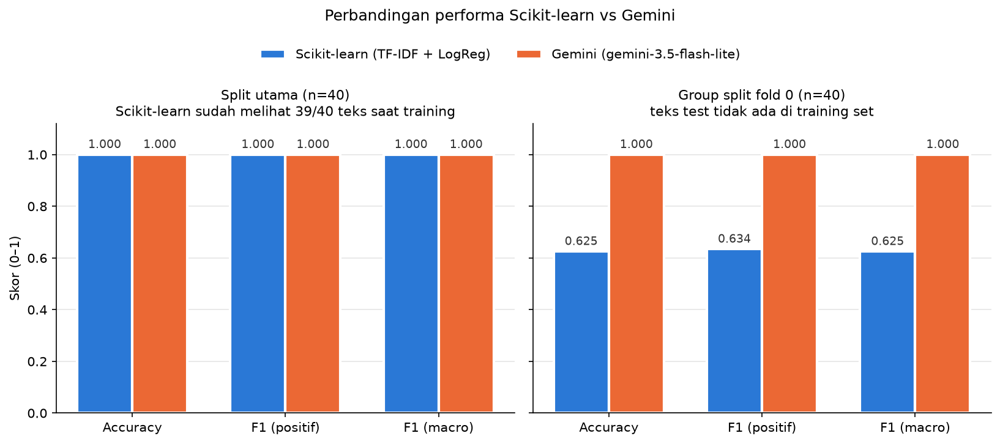
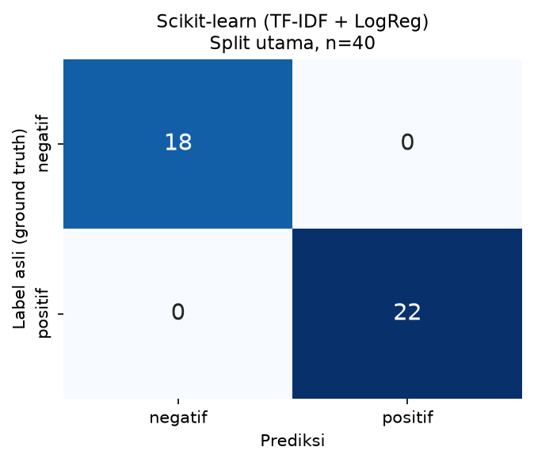
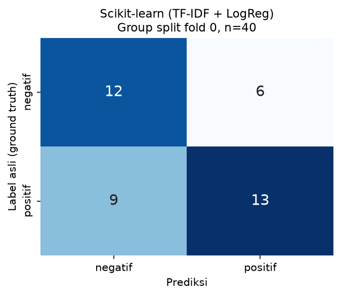
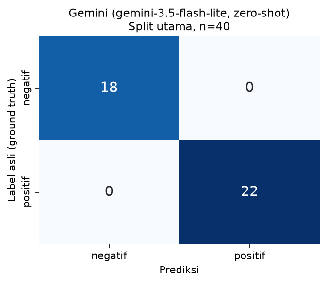
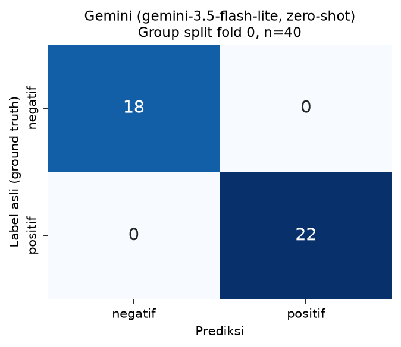

# AI Model Experiment & Evaluation: Sentiment Analysis Ulasan Pelanggan

Individual assignment AI Engineering Bootcamp. Di repo ini saya membandingkan dua cara mengklasifikasikan sentimen ulasan pelanggan e-commerce (positif/negatif):

1. Model klasik: TF-IDF + Logistic Regression yang dilatih dengan Scikit-learn.
2. LLM API: Gemini (`gemini-3.5-flash-lite`) dengan prompt zero-shot, tanpa training.

Kedua pendekatan dijalankan pada test set yang sama, dievaluasi dengan metrik yang sama, lalu dibandingkan dari sisi performa, effort, kecepatan, dan biaya. Seluruh kode dan output ada di `notebook/experiment_notebook.ipynb`.

## Problem statement

Tim produk e-commerce ingin menampilkan label sentimen untuk setiap ulasan di halaman produk secara otomatis. Sebelum memilih pendekatan untuk produksi, tim butuh eksperimen awal yang membandingkan model yang dilatih sendiri dengan LLM berbasis API.

Objective eksperimen ini:
- mengukur Accuracy, Precision, Recall, F1-Score, dan confusion matrix kedua pendekatan pada test set yang sama;
- membandingkan effort implementasi, kecepatan, dan biaya;
- memberi rekomendasi pendekatan yang layak dikembangkan, dengan alasan yang didukung hasil eksperimen.

### Target/label

Kolom `sentiment`, klasifikasi biner:

| Label | Arti |
|---|---|
| `positif` | Pelanggan puas: produk sesuai deskripsi, kualitas baik, pengiriman cepat, penjual ramah. |
| `negatif` | Pelanggan kecewa: barang rusak atau tidak sesuai, pengiriman lambat, penjual tidak responsif. |

Input untuk kedua model hanya kolom `review_text`.

### Batasan dan asumsi

- Dataset dipakai apa adanya. File CSV tidak diubah; semua pengolahan dilakukan di memori.
- Hanya ada dua kelas. Ulasan netral atau campuran tetap harus masuk ke salah satu label.
- Label di dataset dianggap benar.
- `product_name` dan `review_id` tidak dipakai sebagai fitur. `review_id` hanya dipakai untuk mencocokkan sampel test antara kedua model.
- `positif` dipakai sebagai kelas positif untuk Precision/Recall/F1 binary. Macro-average ditampilkan sebagai pembanding.
- Gemini dipakai zero-shot, tanpa fine-tuning dan tanpa contoh dari dataset.
- Training deep learning dari nol di luar scope assignment.

## Dataset

File: `data/customer_reviews_sentiment.csv` (dataset yang dibagikan di brief, tidak dimodifikasi).

| Kolom | Isi |
|---|---|
| `review_id` | ID ulasan (1–200) |
| `product_name` | Nama produk, misalnya "Case HP", "Rice Cooker" |
| `review_text` | Teks ulasan dalam Bahasa Indonesia |
| `sentiment` | Label: `positif` atau `negatif` |

Hasil eksplorasi:
- 200 baris, tidak ada missing value.
- 110 positif (55%) dan 90 negatif (45%).
- Ulasannya pendek, 6–11 kata.
- **Hanya ada 40 teks unik** (20 positif, 20 negatif). Setiap teks muncul 1–12 kali dengan `review_id` dan `product_name` yang berbeda. Tidak ada teks identik dengan label berbeda.

Poin terakhir ini berpengaruh besar ke evaluasi, dan dibahas di bagian berikutnya.

## Struktur project

```text
model-experiment-assignment/
├── data/
│   ├── customer_reviews_sentiment.csv     # dataset asli
│   └── gemini_predictions.csv             # output mentah, label, latensi, dan token setiap request Gemini
├── notebook/
│   └── experiment_notebook.ipynb          # starter notebook yang sudah diisi
├── documentation/
│   ├── confusion_matrix_sklearn.png
│   ├── confusion_matrix_sklearn_group.png
│   ├── confusion_matrix_gemini.png
│   ├── confusion_matrix_gemini_group.png
│   ├── model_comparison.png
│   └── comparison_metrics.csv             # tabel perbandingan lengkap
├── .env                                   # API key (tidak di-commit)
├── .gitignore
├── README.md
└── requirements.txt
```

## Desain eksperimen

### Split utama

Sesuai starter notebook: `train_test_split(test_size=0.2, random_state=42, stratify=y)`, menghasilkan 160 baris train (88 positif, 72 negatif) dan 40 baris test (22 positif, 18 negatif). Test set yang sama dikirim ke Gemini, dan urutannya dicocokkan lewat `review_id`.

Masalahnya, 39 dari 40 baris test punya teks yang persis sama di training set. Test set juga hanya berisi 26 teks unik. Jadi model Scikit-learn diuji pada kalimat yang sudah ia lihat saat training, dan skornya di split ini tidak bisa dibaca sebagai kemampuan pada ulasan baru. Gemini tidak terpengaruh karena tidak memakai data training.

### Evaluasi tambahan

Split utama tetap jadi eksperimen utama. Untuk melihat dampak duplikasi, saya menambahkan dua analisis:

1. **26 teks unik di test set utama.** Setiap teks dihitung satu kali. Analisis ini hanya menghilangkan efek frekuensi duplikat; teksnya tetap ada di training set, jadi ini bukan evaluasi bebas leakage.
2. **Group split berdasarkan `review_text`.** `StratifiedGroupKFold(n_splits=5, shuffle=True, random_state=42)`, dengan fold 0 sebagai holdout (ditetapkan sebelum training). Hasilnya 160 baris train dan 40 baris test (22 positif, 18 negatif), dengan 8 teks unik di test (4 per kelas), dan tidak ada teks yang muncul di train sekaligus test. Scikit-learn dilatih ulang pada train set ini, dan Gemini dijalankan pada test set yang sama. Untuk Scikit-learn juga ditampilkan hasil kelima fold sebagai cek stabilitas.

Keterbatasannya: test group split hanya berisi 8 kalimat, jadi satu kalimat yang salah bisa menggeser skor cukup jauh.

## Pendekatan 1: Scikit-learn

- `TfidfVectorizer()` dengan pengaturan default (lowercase, unigram). Stopword removal tidak dipakai karena daftar stopword Bahasa Indonesia biasanya memuat kata seperti *tidak* dan *belum*, yang justru membalik sentimen.
- `LogisticRegression(max_iter=1000, random_state=42)`, `C=1.0` default. Tidak ada tuning hyperparameter, supaya tidak ada keputusan yang diambil dari test set.
- Vectorizer di-fit hanya pada data train. Untuk group split dipakai `Pipeline` dengan konfigurasi yang sama.
- Waktu diukur dengan `time.perf_counter()`, median dari 20 kali ulang di CPU laptop.

## Pendekatan 2: Gemini API

Prompt zero-shot dalam Bahasa Indonesia:

```text
Tentukan sentimen ulasan pelanggan e-commerce berikut.

Pilihan label:
- positif: pelanggan menunjukkan rasa puas terhadap produk, pengiriman, atau pelayanan penjual.
- negatif: pelanggan menunjukkan rasa kecewa atau keluhan terhadap produk, pengiriman, atau pelayanan penjual.

Nilai hanya berdasarkan isi ulasan. Jawab dengan satu kata saja: positif atau negatif.

Ulasan: """{review_text}"""
Sentimen:
```

Saya memilih zero-shot karena dua alasan. Pertama, perbandingannya jadi bersih: Gemini sama sekali tidak memakai data training. Kedua, contoh few-shot dari dataset ini kemungkinan besar identik dengan kalimat di test set. Prompt ditulis sebelum Gemini dijalankan dan tidak diubah setelah melihat hasil.

### Parameter

| Parameter | Nilai | Alasan |
|---|---|---|
| Model | `gemini-3.5-flash-lite` | `gemini-2.0-flash` dari starter sudah tidak tersedia untuk API key yang dipakai, dan `gemini-2.5-flash` sudah ditandai deprecated di halaman harga. Varian flash-lite cukup untuk klasifikasi kalimat pendek, cepat, dan murah. |
| `temperature` | 0.0 | Klasifikasi butuh jawaban konsisten. Teks yang sama sebaiknya dapat label yang sama. |
| `thinking_level` | `minimal` | Penalaran panjang tidak diperlukan untuk kalimat pendek dan hanya menambah latensi serta token yang ditagih. |
| Output | `text/x.enum`, `['negatif', 'positif']` | Membatasi output ke dua label. Output tetap dinormalisasi dan divalidasi di kode. |
| Retry | maks. 6 percobaan, jeda 5–60 detik | Hanya untuk rate limit (429), error server (5xx), dan gangguan jaringan. |

Setiap baris test dikirim satu per satu (80 request: 40 split utama + 40 group split), termasuk teks yang duplikat. Dengan begitu konsistensi jawaban untuk kalimat yang sama bisa dicek. Request yang gagal atau output yang tidak valid dicatat sebagai `GAGAL`/`INVALID` dan tidak diubah menjadi label apa pun. Pada run ini, semua 80 request berhasil dengan output valid.

Hasil disimpan di `data/gemini_predictions.csv` (run 15 November 2026, 00:48). Notebook memakai file ini saat dijalankan ulang, supaya API tidak dipanggil berkali-kali dan angka di README tetap sama dengan notebook.

## Hasil evaluasi

Semua metrik dihitung dengan fungsi yang sama untuk kedua model. Precision/Recall/F1 binary memakai `pos_label='positif'`. Confusion matrix memakai urutan label `negatif`, `positif` (baris = label asli, kolom = prediksi).

| Evaluasi | n | Accuracy (95% CI Wilson) | Precision (pos) | Recall (pos) | F1 (pos) | F1 (macro) |
|---|---|---|---|---|---|---|
| Scikit-learn, split utama | 40 | 1.000 [0.912, 1.000] | 1.000 | 1.000 | 1.000 | 1.000 |
| Gemini, split utama | 40 | 1.000 [0.912, 1.000] | 1.000 | 1.000 | 1.000 | 1.000 |
| Scikit-learn, 26 teks unik | 26 | 1.000 [0.871, 1.000] | 1.000 | 1.000 | 1.000 | 1.000 |
| Gemini, 26 teks unik | 26 | 1.000 [0.871, 1.000] | 1.000 | 1.000 | 1.000 | 1.000 |
| Scikit-learn, group split | 40 | **0.625** [0.470, 0.758] | 0.684 | 0.591 | 0.634 | 0.625 |
| Gemini, group split | 40 | **1.000** [0.912, 1.000] | 1.000 | 1.000 | 1.000 | 1.000 |
| Scikit-learn, group split per teks unik | 8 | 0.750 [0.409, 0.929] | 0.750 | 0.750 | 0.750 | 0.750 |
| Gemini, group split per teks unik | 8 | 1.000 [0.676, 1.000] | 1.000 | 1.000 | 1.000 | 1.000 |

Precision dan Recall macro ada di notebook dan di `documentation/comparison_metrics.csv`. Cek stabilitas 5-fold group split untuk Scikit-learn menghasilkan rata-rata accuracy 0.643 ± 0.159 (per fold: 0.625, 0.732, 0.385, 0.675, 0.800).



### Confusion matrix

| | Split utama | Group split |
|---|---|---|
| Scikit-learn |  |  |
| Gemini |  |  |

### Cara membaca hasilnya

- Accuracy adalah proporsi prediksi yang benar. Precision (positif) menjawab: dari ulasan yang ditandai positif, berapa yang memang positif. Recall (positif) menjawab: dari semua ulasan positif, berapa yang tertangkap. F1 menggabungkan keduanya. F1 macro merata-ratakan F1 kelas positif dan negatif, sehingga kelemahan di salah satu kelas tetap terlihat.
- False Positive (negatif diprediksi positif) berarti keluhan pelanggan tidak terdeteksi. False Negative (positif diprediksi negatif) berarti produk terlihat lebih buruk dari kenyataannya.
- Di split utama dan 26 teks unik, kedua model sempurna. Untuk Scikit-learn, angka ini datang dari kalimat yang sudah ia lihat saat training.
- Di group split, Scikit-learn turun ke accuracy 0.625 (6 FP, 9 FN). Per kalimat, ia salah di 2 dari 8:
  - *"Produknya rapi dan bersih, tidak ada cacat sama sekali."* (positif) diprediksi negatif. Kata *tidak*, *cacat*, dan *sekali* berbobot negatif di training set, dan model tidak paham negasi.
  - *"Bahan murahan, tidak sesuai dengan harga yang dibayarkan."* (negatif) diprediksi positif. Kata *murahan* tidak ada di vocabulary training, sementara *bahan* dan *sesuai* berbobot positif.
- Gemini benar di kedua kalimat itu dan di semua sampel lain. 16 kalimat yang dikirim lebih dari sekali selalu mendapat label yang sama.
- Interval Wilson per teks unik untuk Gemini di group split masih lebar ([0.676, 1.000]). Keunggulannya jelas di data ini, tetapi 8 kalimat belum cukup untuk menyimpulkan seberapa akurat Gemini pada ulasan nyata.

## Analisis trade-off

### Performa

Kalau hanya melihat split utama, kedua model tampak setara. Pada kalimat yang belum pernah dilihat, Gemini jauh lebih baik (1.000 vs 0.625 accuracy). Kesalahan Scikit-learn punya pola yang jelas: negasi dan kata baru. Gemini tidak membuat kesalahan di eksperimen ini, jadi kelemahannya belum bisa dianalisis.

### Effort implementasi

Scikit-learn hanya butuh beberapa baris kode dan training-nya selesai dalam milidetik. Tapi kualitasnya bergantung pada data berlabel, dan 40 kalimat jelas tidak cukup. Effort terbesarnya adalah mengumpulkan dan melabeli data, lalu retrain secara berkala.

Gemini tidak butuh data training. Kerjanya pindah ke integrasi: mengelola API key, retry dan rate limit, validasi output, caching, dan mengikuti siklus versi model. Contoh nyata dari eksperimen ini: model di starter sudah tidak tersedia, jadi harus diganti dan dievaluasi ulang.

### Kecepatan

| | Scikit-learn | Gemini |
|---|---|---|
| Training | ~2 ms (median 20x) | tidak ada |
| Inference per review | ~0.008 ms | median 0.685 s (min 0.441, maks 1.693) |
| 40 review | ~0.32 ms | 83.7 s (split utama), 166.4 s (group split), termasuk jeda retry |

Waktu Scikit-learn diukur di CPU lokal. Waktu Gemini adalah durasi panggilan API, sudah termasuk jaringan. Training dan inference dilaporkan terpisah karena aktivitasnya berbeda. Dari 80 request, 9 baru berhasil di percobaan ke-2 sampai ke-4. Penyebabnya tidak tercatat di run ini (kemungkinan rate limit); pencatatan error retry sudah ditambahkan ke kode untuk run berikutnya.

### Biaya

Token aktual eksperimen: 8145 input + 160 output + 0 thinking = 8305 token. Dengan harga paid tier `gemini-3.5-flash-lite` (US$0.30 per 1 juta token input, US$2.50 per 1 juta token output; sumber [Gemini API pricing](https://ai.google.dev/gemini-api/docs/pricing), dicek 15 November 2026), biayanya sekitar **US$0.0028**. Model ini juga punya free tier, dan tier akun tidak dicek dari notebook, jadi angka ini adalah biaya dengan asumsi tarif paid tier, bukan tagihan aktual.

Estimasi untuk volume lebih besar, dengan asumsi rata-rata 101.8 token input dan 2 token output per ulasan:

| Jumlah ulasan | Estimasi biaya Gemini | Waktu Gemini jika sekuensial | Inference Scikit-learn |
|---|---|---|---|
| 1 ribu | US$0.04 | 0.19 jam | < 0.01 detik |
| 100 ribu | US$3.55 | 19 jam | 0.8 detik |
| 1 juta | US$35.54 | 190 jam | 7.9 detik |

Waktu Gemini bisa dipangkas dengan request paralel, tetapi tetap dibatasi rate limit. Scikit-learn tidak punya biaya per request; biayanya ada di pelabelan data, waktu engineer, dan server kecil. Komponen-komponen ini tidak diukur di sini.

## Limitations

Data dan desain eksperimen:
- Hanya 40 kalimat unik, pendek, dengan sentimen yang eksplisit. Tidak ada sarkasme, ulasan campuran, slang, typo, atau ulasan panjang. Performa pada ulasan nyata kemungkinan lebih rendah.
- Split utama mengandung leakage untuk model klasik. Group split menghilangkannya, tapi test set-nya hanya 8 kalimat.
- Label tidak diverifikasi ulang, dan tidak ada kelas netral.

Scikit-learn:
- Cenderung menghafal kalimat. Kata netral seperti *sudah*, *yang*, *ada*, dan *seller* ikut mendapat bobot besar.
- Tidak memahami negasi dan tidak bisa menilai kata yang tidak ada di training set (dua kesalahan di group split).
- Perlu data berlabel yang jauh lebih banyak dan retrain berkala.

Gemini:
- Bergantung pada internet dan layanan pihak ketiga. 9 dari 80 request perlu dicoba ulang.
- Model bisa deprecated atau berganti versi, dan setiap pergantian butuh evaluasi ulang.
- Konsistensi hanya dicek pada `temperature=0` dan 16 kalimat yang berulang. Determinisme penuh tidak dijamin oleh API.
- Output dipaksa ke dua label, jadi model tidak bisa menyatakan ragu.
- Isi ulasan dikirim ke server Google, jadi kebijakan data perlu dicek untuk produksi.
- Tidak ada kesalahan yang teramati. Itu belum berarti Gemini bebas kesalahan.

## Rekomendasi

Saya merekomendasikan **Gemini zero-shot sebagai pendekatan yang dikembangkan lebih lanjut**, dengan klasifikasi asinkron: label dihitung sekali saat ulasan dikirim, lalu disimpan.

Alasannya:
1. Fitur ini akan selalu menerima ulasan baru. Satu-satunya evaluasi yang menguji kemampuan itu adalah group split, dan di sana Gemini benar 8/8 kalimat sementara Scikit-learn 6/8 (rata-rata 5-fold 0.643). Skor 1.000 Scikit-learn di split utama tidak saya jadikan dasar keputusan karena berasal dari leakage.
2. Data yang tersedia (40 kalimat) tidak cukup untuk melatih model klasik yang andal. Kesalahan yang muncul (negasi, kata baru) akan sering terjadi di produksi.
3. Biayanya kecil, sekitar US$35 per 1 juta ulasan dengan prompt sependek ini.
4. Latensi sekitar 0.7 detik tidak jadi masalah kalau klasifikasi tidak dilakukan saat halaman dimuat.

Sebelum dipakai di produksi, ada beberapa hal yang perlu disiapkan:
- Evaluasi ulang pada sampel ulasan nyata yang lebih besar dan lebih beragam, dengan label dari manusia.
- Antrean asinkron dengan retry. Ulasan yang gagal diproses ditandai "belum diklasifikasi" dan dicoba lagi, bukan diberi label default.
- Versi model dikunci dan dicatat di setiap prediksi, dengan evaluasi ulang setiap kali migrasi.
- Pengecekan kebijakan privasi sebelum mengirim ulasan ke API eksternal.

Model klasik bisa jadi pilihan yang lebih baik kalau volume ulasan sangat besar, label harus keluar real-time tanpa jaringan, data tidak boleh keluar dari infrastruktur sendiri, atau sudah ada dataset berlabel yang besar (misalnya label Gemini yang sudah diverifikasi manusia). Pada kondisi terakhir, model klasik perlu dilatih ulang dan diuji dengan group split sebelum bisa menggantikan atau mendampingi Gemini. Itu eksperimen terpisah yang tidak saya jalankan di sini.

## Cara menjalankan

### 1. Siapkan environment

Butuh Python 3.11 atau lebih baru (diuji dengan Python 3.14.4 di macOS).

```bash
git clone <url-repo-ini>
cd model-experiment-assignment
python3 -m venv .venv
source .venv/bin/activate          # Windows: .venv\Scripts\activate
pip install -r requirements.txt
```

### 2. Atur API key Gemini

Buat file `.env` di root project (sejajar dengan `README.md`):

```env
GEMINI_API_KEY=isi_dengan_api_key_anda
```

API key bisa dibuat di [Google AI Studio](https://aistudio.google.com/apikey). File `.env` sudah masuk `.gitignore`, jadi tidak ikut ter-commit. Notebook membaca key dengan `python-dotenv` dan tidak pernah mencetak nilainya. Kalau key tidak ditemukan, cell Setup API akan berhenti dengan pesan error.

### 3. Jalankan notebook

Lewat VS Code: buka `notebook/experiment_notebook.ipynb`, pilih kernel Python dari `.venv`, lalu klik **Run All**.

Lewat terminal:

```bash
jupyter nbconvert --to notebook --execute --inplace notebook/experiment_notebook.ipynb
```

Notebook memakai path relatif terhadap folder `notebook/`. Kedua cara di atas sudah otomatis menjalankannya dari folder tersebut.

Secara default, Section 5.3 memakai hasil Gemini yang tersimpan di `data/gemini_predictions.csv`, sehingga notebook tidak memanggil API dan hasilnya sama dengan README ini. Untuk memanggil Gemini lagi (80 request, sekitar 2–4 menit tergantung rate limit), ubah `RERUN_GEMINI = False` menjadi `True` di Section 5.3. Hasil baru akan menimpa file CSV tersebut, dan angka latensi, token, maupun prediksinya bisa sedikit berbeda dari yang tertulis di sini.
